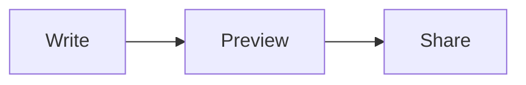

# Welcome to Markise

Markise is a Markdown editor that shows your text the way it will look while you write it. The file on disk stays plain Markdown, readable by any other tool.

This page is a hands-on tour. It is a scratch copy: edit it, break it, tick the boxes. Your own files are never touched. Shortcuts are shown for macOS; on Windows and Linux most of them use **Ctrl** where you see **⌘**, and **⌘?** (**Ctrl+?** there) lists the exact keys for your system.

- [ ] Click this box to tick it. Click again to untick it.

## 1. Write and format

Type normally. Select a word and try:

| Style | Shortcut | Markdown |
|---|---|---|
| **Bold** | ⌘B | `**bold**` |
| *Italic* | ⌘I | `*italic*` |
| <u>Underline</u> | ⌘U | `<u>underline</u>` |
| `Code` | ⌃\` | `` `code` `` |
| ~~Strike~~ | ⌃⇧\` | `~~strike~~` |
| [Link](https://example.com) | ⌘K | `[text](url)` |
| Clear formatting | ⌘\\ | |

You can also type the Markdown yourself: write `**word**` and it turns bold as soon as you close it.

- [ ] Make a word bold, then remove the bold with ⌘\\.
- [ ] Turn a word into a link with ⌘K.

## 2. Headings and structure

Put the cursor in any line and press **⌘1** to **⌘6** for a heading, **⌘0** to turn it back into a paragraph. Or start a line with `#`, `##`, `###` and a space.

- [ ] Turn the next line into a heading, then back into a paragraph.

Practice line: make me a heading.

The outline in the sidebar lists every heading. Click one to jump to it.

## 3. Lists, tasks and quotes

Start a line with `- ` for a bullet list, `1. ` for a numbered list, `- [ ] ` for a task. **Tab** indents an item, **⇧Tab** outdents it, and **Enter** on an empty item ends the list.

- Bullet
  - Nested bullet
- [ ] A task you can tick
1. First
2. Second

> A quote. Start a line with `> ` or press ⌥⌘Q.

- [ ] Add a third item to the numbered list above.
- [ ] Move a list item up or down with ⌥↑ / ⌥↓.

## 4. Tables

| Feature | Where |
|:---|:---:|
| Add or delete rows and columns | Paragraph → Table |
| Align a column | Paragraph → Table |

Click into a cell and type. **Tab** moves to the next cell.

- [ ] Add a row to this table from the Paragraph → Table menu.

## 5. Code, math and diagrams

Fenced code gets syntax highlighting. Click the language label to change it, or the copy button to copy the code.

```rust
fn main() {
    println!("Hello from Markise");
}
```

Math uses LaTeX: inline $e^{i\pi} + 1 = 0$, or a block:

$$
\int_0^1 x^2\,dx = \frac{1}{3}
$$

Diagrams use Mermaid:



- [ ] Change `Share` in the diagram to `Publish` and watch it redraw.

## 6. See the Markdown

- **⌘/** switches between the rendered view and the plain Markdown source.
- **⌃⌘/** opens Side by Side: source on the left, rendered on the right, scrolling together.

- [ ] Press ⌘/ to see how this page is written, then ⌘/ again to come back.
- [ ] Try Side by Side with ⌃⌘/.

## 7. Find and replace

**⌘F** finds text in the document, **⌘G** / **⇧⌘G** go to the next / previous match, and **⌥⌘F** opens Replace. Case, whole word and regular expressions are options in the find bar. Replace All is one undo step.

- [ ] Find every "Markise" on this page.

## 8. Folders, links and notes

Open a folder with **⇧⌘O**. The sidebar shows its files, and **⌘P** (Quick Open) finds any file by name. File → Open Recent remembers files and folders.

Link notes to each other with `[[wikilinks]]`, for example [[My first note]]. In an opened folder, ⌘-click a link to follow it; if the note doesn't exist yet, Markise offers to create it next to the note that links to it. **⌥⌘←** / **⌥⌘→** go back and forward.

Paste or drag an image into a note and Markise copies it into an `assets` folder next to the note (Preferences → Files & Images can change that). On an unsaved page like this one, images go to Markise's own app-data folder.

- [ ] Open a folder of your own notes with ⇧⌘O.

## 9. Comments and suggestions

Review marks are stored in the text itself, so they survive any tool. Comments look like `{>>a comment<<}`, and suggested changes like `{++insertion++}`, `{--deletion--}` and `{~~old~>new~~}`. Markise shows them as margin cards that you can accept or reject. File → Save Copy Without Comments writes a clean version.

Here is a sentence {++with a suggested insertion++} and {>>a comment<<}.

- [ ] Accept or reject the suggestion above.

## 10. Make it yours

- **Themes:** View → Theme switches between themes; View → Theme → Theme Settings… has all theme options, including Import Theme… for a CSS theme.
- **Zoom:** ⇧⌘= / ⇧⌘- / ⇧⌘0 zoom the whole window.
- **Full screen:** ⌃⌘F.
- **Preferences:** ⌘, for fonts, autosave, smart punctuation and more.

## 11. Your work is safe

Markise keeps a draft of unsaved changes. If the app or your computer crashes, it offers to recover them on the next launch (File → Recover Unsaved Drafts). It never silently overwrites a file that another program changed on disk.

Big files are fine too: Markise is built to edit documents of tens of megabytes smoothly.

---

That's the tour. Open this page again from **Help → Tutorial**, and see every shortcut with **⌘?**. Happy writing.
