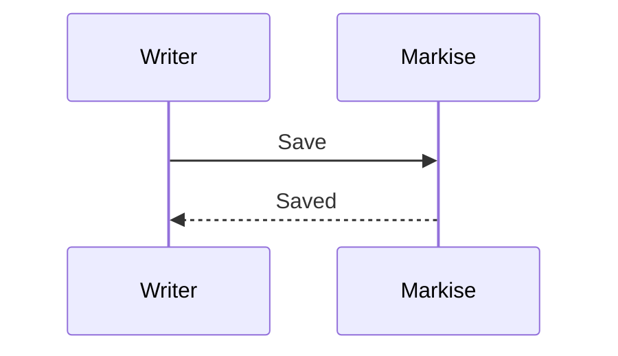

# Math and diagrams

## Math

Markise renders TeX math with a KaTeX-compatible engine that is built into the app; no
internet connection or JavaScript is needed.

| Write | For |
|---|---|
| `$…$` or `\(…\)` | inline math, inside a sentence |
| `$$` on its own lines, `\[…\]`, or a ` ```math ` fence | a display block |

For example, `$e^{i\pi} + 1 = 0$` gives $e^{i\pi} + 1 = 0$, and this block:

```text
$$
\int_0^1 x^2\,dx = \frac{1}{3}
$$
```

renders as

$$
\int_0^1 x^2\,dx = \frac{1}{3}
$$

**Format → Inline Math** (<kbd>Ctrl+M</kbd> on macOS) inserts inline math. Chemistry formulas
with `\ce{…}` (mhchem) work too.

If a formula has an error, Markise shows its TeX source in a warning colour instead of the
rendering; fix the source and it renders again.

## Diagrams

A fenced code block with one of these languages is drawn as a diagram:

| Fence | Syntax | Drawn |
|---|---|---|
| `mermaid` | Mermaid | flowcharts (`flowchart`, `graph`) and sequence diagrams (`sequenceDiagram`) |
| `sequence` | js-sequence-diagrams | sequence diagrams |
| `flow` | flowchart.js | flowcharts |

A Mermaid flowchart:

````text

````


A sequence diagram:



Edit the source in Source Code Mode or Side by Side and the diagram redraws.

To read a wide diagram, open it in a full-window view: double-click it, or hover it and press
the expand button under it. The diagram is redrawn sharply at whatever size you view it. The
mouse wheel or a pinch zooms around the pointer, dragging pans, and <kbd>+</kbd>, <kbd>-</kbd>
and <kbd>0</kbd> zoom in, zoom out and fit it to the window again. <kbd>Esc</kbd> or a click
outside the diagram closes the view. It only shows the diagram; the document does not change.
[Images](editing.md#images) open the same way.

Other Mermaid diagram types — class, state, Gantt, pie and so on — are not drawn yet. Markise
shows their source with a note ("Mermaid diagram type … is not supported yet"), and the same
fallback applies when a diagram has a syntax error, is too large, or takes too long to lay out.

**Preferences → Markdown → Render diagrams** turns diagram drawing off; the fences then stay
code blocks.

## In exports

- **HTML** export contains math and diagrams as SVG pictures, so the file needs no scripts or
  fonts to show them.
- **PDF** and **PNG** export show math and diagrams as their source text in the beta.
- **Pandoc** formats receive math as native math (for example Word equations) and diagrams as
  code blocks.

See [Export](export.md).
