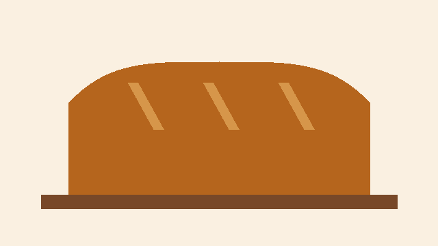

# Weeknight loaf

A plain white loaf that fits around a working day. Everything below is ordinary Markdown: a block
is a `:::name` line, its content and a `:::` line, so any text editor can change this file.

:::ingredients 8

### For one loaf

- 500 g strong white flour
- 350 ml warm water
- 7 g dried yeast
- 10 g salt

> Bread flour gives a taller loaf, but plain flour works.

:::

Mix everything, then follow the times below.

:::timing

### From bowl to table

- Knead, 10 min
- First rise, 60 min
- Shape and rest, 30 min
- Bake, 35 min

:::

:::tip

#### Is it done?

Tap the bottom of the loaf. It should sound hollow.

:::

:::tip warning

Let the tin cool before you wash it. Cold water can warp hot metal.

:::

:::question

What makes the dough rise?

- [ ] The salt {#a1}
- [x] The yeast {#a2}
- [ ] The warm tin {#a3}

> Yeast feeds on the flour and gives off gas, and the dough holds it.

:::
